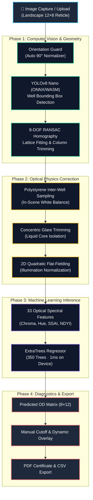

# Mobile ELISA Plate Reader — System Architecture

A lightweight, 100% offline edge-AI diagnostic system that converts smartphone photos into laboratory-grade spectrophotometer optical density (OD) readings for rapid aquaculture pathogen screening.

---

## 1. End-to-End Pipeline

---

## 2. Core Architectural Pillars

| Stage | Technology | Function |
| :--- | :--- | :--- |
| **1. Vision & Geometry** | YOLOv8 Nano + RANSAC Homography | Detects circular wells, rectifies camera perspective tilt, and auto-detects column span (10, 11, or 12 columns) without false frame detections. |
| **2. Optical Physics** | Quadratic Flat-Fielding + Polystyrene Sampling | Samples in-scene plastic nodes to remove uneven shadows, vignette, and meniscus glare across the plate. |
| **3. Machine Learning** | ExtraTrees Ensemble (Compiled JSON) | Evaluates 33 chromatic and spectral features per well to predict spectrophotometer OD ($0.00 - 5.50\text{ OD}$) in $< 1\text{ ms}$. |
| **4. Diagnostic Engine** | Real-Time Canvas Re-Renderer | Dynamically updates Positive (Red), Borderline (Amber), and Negative (Green) statuses as the user adjusts the diagnostic cutoff. |

---

## 3. Technology Stack

- **Application Core**: React 19, TypeScript, Vite, TailwindCSS, Lucide Icons.
- **On-Device Edge AI**: ONNX Runtime Web (WASM SIMD) + Native Client-side Decision Trees.
- **Mobile Packaging**: Capacitor 7 (Android Native Camera HAL, Offline Storage, Filesystem & Native Sharing).
- **Report Generation**: `pdf-lib` (client-side A4 clinical certificate generation).
- **Zero-Cloud Guarantee**: Operates completely in airplane mode with no external servers, APIs, or data transmission.
